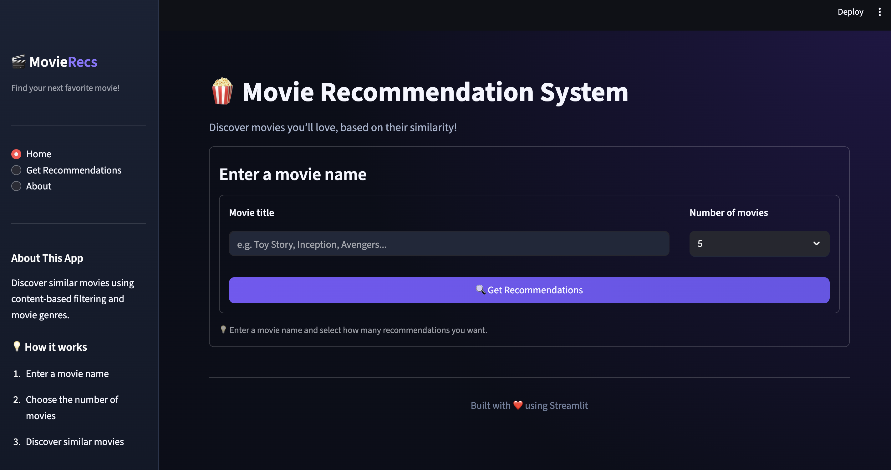

# 🎬 MovieRecs — Movie Recommendation System

A movie recommendation web application built with **Python, Streamlit, and Scikit-learn**. MovieRecs uses content-based filtering and cosine similarity to recommend movies with genres similar to a movie selected by the user.

Explore movies through a clean, dark-themed interface and choose how many recommendations you want to see.

📸 UI Preview



## ✨ Features

- 🎥 **Content-Based Recommendations** — Discover movies with similar genres.
- 🔍 **Movie Search** — Search for a movie by its title.
- 🔢 **Custom Recommendation Count** — Choose to see 5, 10, 15, or 20 recommendations.
- 🧠 **Cosine Similarity** — Compare movie genre feature vectors.
- 🎨 **Custom UI** — Dark cinematic interface built with Streamlit and custom CSS.
- 📊 **MovieLens Dataset** — Uses movie metadata from MovieLens 1M.

## 🛠️ Tech Stack

| Technology | Purpose |
|---|---|
| Python | Core programming language |
| Streamlit | Interactive web application |
| Pandas | Dataset loading and processing |
| Scikit-learn | Genre encoding and similarity calculation |
| MultiLabelBinarizer | Convert genres into binary feature vectors |
| Cosine Similarity | Measure similarity between movies |
| Custom CSS | Style the user interface |

📈 Exploratory Data Analysis (EDA)

Here are key insights and data distributions analyzed from the MovieLens dataset used in this project:

1. Distribution of Ratings

Shows the frequency of each rating score (from 1 to 5) given by users across the dataset.
[](rating_distribution.png)

2. Movies Released Per Year

Tracks the volume of movies released across different years in the dataset.
[](movies_per_year.png)

3. Number of Ratings by Genre

Highlights user engagement and popularity across different movie genres.
[](rating_by_genre.png)

4. Top 5 Genres with 5-Star Ratings

Identifies which genres accumulate the highest count of top-tier 5-star reviews.
[](top_genre.png)

5. Top 20 Most Rated Movies

Displays the movies with the highest interaction and rating counts from users.
[](top_movies.png)

6. User Age Distribution

Breaks down user demographics based on age brackets.
[](user_with_diff_ages.png)

7. Average Rating by Gender

Compares overall average rating tendencies between female (F) and male (M) users.
[](avg_rating.png)

8. User Activity vs. Average Rating

Examines the relationship between how active a user is (number of ratings provided) and their average rating tendency.
[](user_rating_vs_avg_rating.png)

9. Feature Correlation Heatmap

Shows linear correlation metrics between movieId, year, userId, rating, and timestamp.
[](heatmap.png)

## ⚙️ How It Works

MovieRecs follows a content-based filtering approach.

1. **Load the dataset:** Read movie titles and genres from `movies.csv`.
2. **Process genres:** Split each movie's genre string into individual genres.
3. **Encode features:** Use `MultiLabelBinarizer` to convert genres into numerical vectors.
4. **Calculate similarity:** Apply cosine similarity to compare the genre vectors of movies.
5. **Generate recommendations:** Find movies with the highest similarity scores to the selected movie.
6. **Display results:** Show the recommended titles and genres in the Streamlit interface.

## 📂 Project Structure

```text
MovieRecs/
├── app.py          # Streamlit user interface
├── model.py        # Recommendation algorithm
├── movies.csv      # Movie dataset
└── README.md       # Project documentation
```

## 🚀 Getting Started

Follow these steps to run MovieRecs on your local machine.

### 1. Clone the repository

```bash
git clone https://github.com/YOUR_USERNAME/MovieRecs.git
cd MovieRecs
```

Replace `YOUR_USERNAME` with your GitHub username.

### 2. Create a virtual environment (recommended)

```bash
python -m venv venv
```

Activate it:

**Windows**
```bash
venv\Scripts\activate
```

**macOS / Linux**
```bash
source venv/bin/activate
```

### 3. Install dependencies

```bash
pip install streamlit pandas scikit-learn
```

### 4. Add the dataset

Place `movies.csv` in the project root directory, alongside `app.py` and `model.py`.

The dataset should contain at least these columns:

- `title` — Movie title
- `genres` — Movie genres separated by `|`

### 5. Run the application

```bash
streamlit run app.py
```

The application will open in your browser.

## 🎯 Example

Suppose a user searches for **Toy Story (1995)** and chooses to see 5 recommendations.

MovieRecs compares its genre profile with other movies and returns the five most similar results according to the implemented similarity algorithm.

*Note: Recommendations are based on genre similarity, not user ratings, viewing history, or plot descriptions.*

## 📚 Dataset

This project uses movie metadata from the **MovieLens 1M dataset**.

Dataset source: [GroupLens Research — MovieLens](https://grouplens.org/datasets/movielens/1m/)

Make sure you prepare `movies.csv` with the required `title` and `genres` columns before running the application.

## 🔮 Future Improvements

- Add movie posters and descriptions.
- Implement collaborative filtering using user ratings.
- Improve movie search with exact-title matching.
- Explore hybrid recommendation techniques.
- Deploy the application online.

## 🤝 Contributing

Contributions, suggestions, and improvements are welcome. Feel free to fork the repository and submit a pull request.

## 📄 License

This project is intended for educational and learning purposes. If you plan to distribute it, consider adding a suitable open-source license and reviewing the dataset's terms of use.

---

**Built with ❤️ using Python, Machine Learning, and Streamlit. 🍿**
